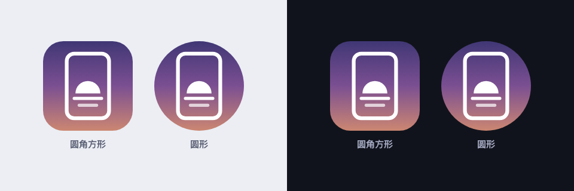

# 壁纸时移 · 设计资料

这份资料用来指导「壁纸时移」各个平台版本的开发。内容提炼自已在 vivo 真机上验收的 Android MVP（2026-10-20），截图都是真机截的。

- **必须一致**：产品概念、品牌与图标、颜色角色、组件的结构与状态、交互与行为规则、文案。不同平台的用户看到的应该是同一个 app。
- **可以随平台**：控件的具体外观（开关、对话框、时间选择器、菜单）、导航方式、系统字体。按平台惯例来，不要为了像 Android 去硬做一套。

可以直接读取的数值都在 [tokens.json](tokens.json) 里；图标源文件在 [icon/](icon/)，示例壁纸的生成脚本在 [demo-wallpapers/](demo-wallpapers/)。真机截图在 `screens/`，只保留在本地，不进公开仓库（见第 7 节）。

---

## 1. 产品概念

**一句话**：按一天中的时间，自动切换手机的锁屏和桌面壁纸。

| 概念 | 含义 |
|---|---|
| 壁纸集 | 一组图片和它们的时间表。可以有多个，**同一时间只启用一个**。 |
| 图片 | 壁纸集里的一张图，带一个**开始时间**（精确到分钟）。 |
| 时间段 | 一张图从自己的开始时间显示到下一张的开始时间；最后一张一直显示到**次日**第一张开始。 |
| 锁屏 / 桌面 | 同一张图：锁屏用**原图**，桌面用**模糊后的图**，这样桌面图标更清楚。 |
| 桌面模糊 | 每个壁纸集一个强度，0（关）到 25，默认 10。 |

---

## 2. 品牌与图标

**名称**：壁纸时移（英文 Wallpaper Shift）。

**图标含义**：手机外框里，一轮半露在地平线上的太阳，下面是地平线和它的倒影。背景从夜空的深蓝渐变到暮色紫，再到日出橙，表达「一天中光线的变化」。



| 规格 | 值 |
|---|---|
| 画布 | 108 × 108（Android 自适应图标标准）。启动器显示中间 72 × 72，安全区是中间直径 66 的圆。 |
| 背景 | 从上到下的线性渐变：`#232B66` → `#7B4F92`（50%）→ `#F4A261` |
| 手机外框 | 圆角矩形 x 37–71、y 28–80，圆角 6，白色描边 3 |
| 太阳 | 圆心 (54, 60)、半径 10 的白色实心圆，只保留地平线（y = 60）以上的半个 |
| 地平线 | (43, 64) → (65, 64)，白色，线宽 2.5，圆头 |
| 倒影 | (47, 69.5) → (61, 69.5)，白色 70% 不透明度，线宽 2.5，圆头 |

**文件**

| 文件 | 用途 |
|---|---|
| [icon/icon.svg](icon/icon.svg) | 正方形满版主图标（108 画布的中间 72），没有透明区域。iOS、桌面端、网页、应用商店都从它导出。 |
| [icon/png/icon-1024.png](icon/png/icon-1024.png)、`icon-512.png`、`icon-192.png` | 渲染好的 PNG。1024 没有透明通道，可以直接用于 App Store。 |
| [icon/adaptive-background.svg](icon/adaptive-background.svg)、[adaptive-foreground.svg](icon/adaptive-foreground.svg) | 自适应图标的背景层和前景层（108 画布）。 |
| [icon/adaptive-monochrome.svg](icon/adaptive-monochrome.svg) | 单色层，用于系统的主题图标。 |

Android 实际使用的是等价的矢量文件：`android/app/src/main/res/drawable/ic_launcher_*.xml`。改图标时两边要同步。

**不要**给图标加文字、阴影或描边，也不要把渐变换成纯色。圆角和圆形遮罩交给系统处理，源文件保持方形满版。

---

## 3. 颜色

**原则：颜色跟着壁纸走。** 支持从壁纸取色的平台（Android 12+ 的 Material You）一律用系统动态配色。这样 app 自己的颜色也会随一天中的壁纸变化，和产品主题一致。截图里出现的暖棕色、深色，都是从示例壁纸取出来的。

不支持取色时，用下面的备用色板。没有列出的角色（surface、error、outline 等）用 Material 3 的默认值。

| 角色 | 浅色 | 深色 |
|---|---|---|
| primary | `#3F4A8A` | `#B9C3FF` |
| onPrimary | `#FFFFFF` | `#0E1D6B` |
| primaryContainer | `#DDE1FF` | `#263271` |
| onPrimaryContainer | `#00105C` | `#DDE1FF` |
| secondary | `#9A4F2B` | `#FFB693` |
| secondaryContainer | `#FFDBCC` | `#7B3816` |
| onSecondaryContainer | `#370E00` | `#FFDBCC` |

**颜色角色的用法**（各平台保持一致）

| 用在哪里 | 角色 |
|---|---|
| 首页「当前壁纸」卡片 | secondaryContainer |
| 设置引导卡、漏切提醒卡 | errorContainer |
| 编辑页的模糊预览卡 | surfaceContainerHigh |
| 当前时段的描边、列表里的开始时间、选中的图片 | primary |
| 危险操作（删除壁纸集） | error，**实心按钮** |
| 次要说明文字 | onSurfaceVariant |
| 图片加载前的占位 | surfaceVariant |
| 叠在图片上的元素（锁屏预览的时钟、桌面预览的图标点） | 固定白色，图标点 75% 不透明度，不随主题变 |

深色主题必须支持。只改文字颜色的强调（比如把「删除」的文字改成红色），在深色下常常和强调色区分不开，要用实心按钮或描边。

---

## 4. 字体与文字层级

使用系统字体（Android：Roboto + 思源黑体；iOS：SF Pro + 苹方）。层级沿用 Material 3 字号，其他平台取最接近的系统样式。

| 用途 | 样式 |
|---|---|
| 页面标题（顶栏） | titleLarge 22/28 |
| 分区标题（「我的壁纸集」「时间表」）、卡片标题、当前图片名 | titleMedium 16/24 中等字重 |
| 行标题（「启用此壁纸集」「桌面模糊：10」） | titleSmall 14/20 中等字重 |
| 设置项名称（「自启动」） | bodyLarge 16/24 |
| 信息行（「17:30–19:30 · 19:30 换成 06-night」） | bodyMedium 14/20 |
| 次要信息（「6 张 · 桌面模糊 10」「显示到 07:30」、设置路径） | bodySmall 12/16 |
| 列表里的开始时间 | headlineSmall 24/32 中等字重，primary 色 |
| 时间表预览下的时间 | labelSmall 11/16。当前时段加粗、用 primary 色 |
| 手机预览下的「锁屏 / 桌面」 | labelMedium 12/16 |
| 锁屏预览里的时钟 | 26，细体（300），白色 |

**时间一律 24 小时制 `HH:mm`，使用等宽数字。**

---

## 5. 布局

两个主页面，加上调用的系统页面（照片选择器、文件选择器、分享面板、系统设置）。

```
首页 ──点壁纸集卡片──▶ 编辑壁纸集
 │                        │
 ├ 顶栏「导入」→ 文件选择器├ 顶栏「导出」、删除
 ├ 当前壁纸卡（有壁纸集时）├ 名称、启用开关
 ├ 设置引导卡（需要时）    ├ 模糊预览卡（两部手机 + 滑块）
 ├ 我的壁纸集（卡片列表）  ├ 时间表：预览行 + 逐张列表
 └ 新建壁纸集（悬浮按钮）  └ 添加图片 → 系统照片选择器
```

| 间距 | 值 |
|---|---|
| 页面左右边距 | 16 |
| 列表项之间 | 12 |
| 卡片内边距 | 16 |
| 列表底部留白（给悬浮按钮） | 96 |
| 两部手机预览之间 | 16 |

---

## 6. 组件

### 6.1 手机预览

用小手机展示壁纸设上去的样子，总是**锁屏、桌面成对出现**，左锁屏右桌面。

- 比例 9 : 19.5，圆角 14，2 的 outlineVariant 描边。图片铺满。
- **锁屏**：原图。顶部 22 处是时钟（26，细体，白色）：首页显示当前时间，编辑页显示这张图的开始时间。
- **桌面**：模糊图。底部 14 处是 2 行 × 4 个图标点（直径 14，白色 75%，间距 8），暗示桌面图标。
- 下方 6 处是说明「锁屏」「桌面」，不写别的。
- 模糊效果必须和真正设到桌面上的**完全一致**（算法见 §8.4），用户在预览里看到什么，桌面上就是什么。

### 6.2 时间表预览

把一个壁纸集的一天，按时间顺序排成一行完整的缩略图。

- 每个时段一张图，放在 9 : 19.5 的圆角（8）框里，**完整显示、不裁剪**。比例不合的图片留边，不要裁掉。
- 图下方 4 处只写**开始时间**。时段持续到下一张开始，不写结束时间。
- 图与图之间间距 6。
- **当前时段**（只在启用中的壁纸集显示）：2.5 的 primary 描边，时间加粗并用 primary 色。
- 宽度规则：先尝试平分整行宽度。每张宽度不小于 40 时就平分，不滚动；小于 40 时改为每张 60 宽，整行可以左右滑动，打开时自动滑到当前那张（左边留一张作为上下文）。图片数量变化时，滚动位置重新定位。
- 点击：在首页，点击交给外层卡片（进入编辑）；在编辑页，点一张图会把上方的模糊预览切换到这张。

> 历史：第一版是按时长比例画的 24 小时色条，每段裁一部分图。用户反馈各段露出的部位不一样，看不懂，所以改成了现在这样完整显示的图片行。

### 6.3 当前壁纸卡（首页顶部）

只在至少有一个壁纸集时出现；一个壁纸集都没有时只显示空状态。

| 状态 | 内容 |
|---|---|
| 未启用 | 标题「未启用」+「打开下方壁纸集的开关，开始按时间切换。」 |
| 正常 | 手机预览一对 → 图片名 → `17:30–19:30 · 19:30 换成 06-night`；只有一张图时写「全天显示这一张」 |
| 预览中 | 手机预览和图片名换成**手机上实际在显示的那张** → `预览中 · 19:30 自动恢复按时间表` → 实心按钮「恢复按时间表」 |
| 设置失败 | 正常内容 + 一行错误色的「上次设置壁纸失败：原因」+ 实心按钮「重试」 |

正常状态下卡片上**没有按钮**。

### 6.4 壁纸集卡片（首页列表）

名称（titleMedium）、`6 张 · 桌面模糊 10`（bodySmall），右侧是启用开关，下面是时间表预览。空壁纸集写「还没有图片」，不显示预览。整张卡片点击进入编辑。

列表按新建（或导入）的时间**倒序**，最新的在最上面，新建、导入的壁纸集一眼就能看到。

### 6.5 设置引导卡 / 漏切提醒卡

后台被系统限制时才出现，用 errorContainer 底色。

- 第一行：警告图标（20）+ 标题（titleSmall）。**标题负责说明原因**：
  - 引导：「还需打开 N 项设置才能准时切换」
  - 漏切：「17:15 的切换没有执行」，下面一行小字「请检查下面的手机设置」
- 每个设置一行，左缩进 28：名称（bodyLarge）+ 色调按钮「去开启 / 去设置」。按钮不能直接到达目标页面时，在下一行用 bodySmall 写出路径，如「电量 → 后台耗电管理 → 允许后台耗电」。
- **能读到设置状态的，自动收起**：每次回到首页都重新检查，用户从设置页回来，打开了的那一项就消失，不需要再点什么。vivo 上「自启动」和「睡眠待机优化」能读到，「后台耗电」读不到（见 [android/README.md](../android/README.md)）。
- 读不到状态的设置，行里多一个**描边按钮「我已设置」**，用户点了这一项就收起。不要用纯文字的「已设置」：放在那个位置像一个状态标签，用户会以为 app 已经认出来了。（真机上出过这个问题：用户打开了两项设置，卡片却一直在。）
- 不写解释性长句。如果之后又检测到漏切，所有项重新出现。

### 6.6 编辑页

- **名称**：带「名称」标签的输入框，边输入边保存。
- **启用此壁纸集**：一行文字 + 开关，没有副标题。
- **模糊预览卡**（surfaceContainerHigh）：一对手机预览（左右各缩进 24）→「桌面模糊：10」，为 0 时显示「关」→ 0–25 的整数滑块。拖动时预览实时变化，松手才保存。
- **时间表**：标题 + 时间表预览（6.2）+ 每张图一行：
  - 缩略图 44 × 88，圆角 8
  - 开始时间（headlineSmall，primary 色），**点它就能修改**
  - 「显示到 07:30」（bodySmall）；跨日时写「显示到 次日 05:00」
  - 图片名（bodyMedium）。来源没有可读文件名时（比如照片选择器只给编号），用「图片 N」
  - 右侧：时钟图标（修改开始时间）+ ⋮ 菜单（立即应用这张、从壁纸集移除）
  - 当前在模糊卡里预览的那一行，用 2 的 primary 描边
- 最底部是整宽主按钮「添加图片」，已有图片时写「继续添加图片」；导入时换成进度「正在导入 3/6…」。
- 顶栏：返回、标题「编辑壁纸集」、文字按钮「导出」（没有图片时不可用，见 8.9）、删除图标。

### 6.7 对话框

- **修改开始时间**：标题「开始时间」，24 小时制，按钮「取消 / 确定」。新时间和别的图片重复时，用提示「07:30 已经有一张图了，换个时间吧」，不要静默覆盖。
- **删除壁纸集**：标题「删除「名称」？」，正文一句「壁纸集和其中导入的图片副本都会被删除。当前桌面和锁屏不会改变。」，「取消」是文字按钮，**「删除」是 error 色实心按钮**。

### 6.8 菜单、按钮与空状态

- 首页顶栏是标题「壁纸时移」，右边一个文字按钮「导入」（见 8.9），**不放菜单**。曾经放过「重新设置当前壁纸」和「导入示例壁纸集」，因为用途说不清、使用频率低，已经去掉。导入用文字而不是图标，是为了一眼看懂。
- 菜单只有编辑页每张图的 ⋮。菜单都要**贴着触发它的按钮弹出**，这一点第一轮出过问题。
- 悬浮按钮：加号图标 +「新建壁纸集」，新建后直接进入编辑。
- 空状态：壁纸图标（48，outline 色）+「还没有壁纸集」+ 小字「点右下角「新建壁纸集」开始」。因为首次启动会自动建好示例壁纸集（见 8.8），用户删光所有壁纸集后才会看到它。
- 首次启动准备示例壁纸集时，列表上方显示进度「正在准备示例壁纸 3/6…」。

### 6.9 功能图标

用 Material Symbols（Android）。其他平台用含义相同的系统图标，例如 iOS 用 SF Symbols：

| 用途 | Material Symbols | SF Symbols（参考） |
|---|---|---|
| 新建 | add | plus |
| 返回 | arrow_back | chevron.backward |
| 删除壁纸集 | delete | trash |
| 修改开始时间 | schedule | clock |
| 添加图片 | add_photo_alternate | photo.badge.plus |
| 更多 | more_vert | ellipsis |
| 警告 | warning | exclamationmark.triangle |
| 空状态 | wallpaper | photo.on.rectangle |

---

## 7. 界面截图

除「首次启动」是在模拟器上截的（为了不清空真机上的数据），其余都是 vivo V2454A 的真机截图。手机在 17:30 自动切到了深色模式，所以大部分是深色主题；首次打开、添加图片、修改开始时间三张是浅色主题，正好对照两种主题。

截图用的是作者自己的壁纸，所以只放在本地的 `design/screens/`（已写进 `.gitignore`），公开仓库里没有。共 15 张：首次启动（浅色，模拟器）、当前壁纸、预览中、壁纸集列表、图片较多时可滑动、设置引导、漏切提醒、空状态（旧版，浅色）、编辑：名称与模糊、编辑：时间表、添加图片（浅色）、修改开始时间（浅色）、单张图片菜单、删除确认、系统锁屏实际效果。

部分截图是旧版，以正文为准：截图里的示例壁纸是第一版的插画，现在已换成图标 LOGO + 渐变色（见 8.8）；首页顶栏的「导入」和编辑页顶栏的「导出」截图里还没有（见 8.9），首页列表现在是倒序；「空状态」是第一轮截的，上方的「尚未启用壁纸集」卡片和「导入示例壁纸集」按钮现在都已去掉；截图里顶栏右上角的 ⋮ 菜单也已去掉（见 6.8）。

---

## 8. 交互与行为规则（各平台必须一致）

### 8.1 时间表

- 一天 1440 分钟。每张图记录开始分钟，图片按开始时间排序。
- 某一时刻显示哪一张：**开始时间 ≤ 现在的最后一张**；如果没有（比如凌晨还没到第一张），就是**最后一张**，也就是前一晚那张延续过来。
- 下一次切换：严格晚于现在的下一个开始时间；今天没有了，就是明天第一张的开始时间。只有一种开始时间时不切换。
- 夏令时：开始时间落在跳过的那一小时里时，向后顺延，不跳过这次切换。
- 同一个壁纸集里**不允许两张图的开始时间相同**。

### 8.2 新图片的默认时间

- 空壁纸集一次加入 N 张：按选择顺序，从 06:00 起把 24 小时平均分成 N 份。
- 已有图片时，每张新图放在当前**最大空档的中点**。
- 都取整到 5 分钟，并且避开已有的时间。用户随后可以修改。

### 8.3 切换

- 一次切换 = 先设**锁屏（原图）**，再设**桌面（模糊图）**。先设锁屏，因为亮屏时最先看到的是锁屏。
- 所有触发（到点、开机、改时间或时区、应用更新、打开 app、编辑启用中的壁纸集）都执行同一个**同步**动作：算出「现在应该显示哪张」，和已经设上的不同才设置，然后**只预约下一个切换点**。同步可以重复执行，晚到、多执行都不会出错。
- 到点触发时，按「到点时间」和「现在」中较晚的那个来计算，避免提前唤醒时选错图。
- 晚到时直接显示应当显示的那张，中间错过的图不补放。

### 8.4 模糊算法（预览和实际壁纸共用）

1. 把图片缩到宽 **240 px**（保持比例）。
2. 做 **3 次**盒式模糊（每次先水平、再竖直），半径 = 模糊强度（0–25）。边缘像素取延伸值。
3. 放大回原图尺寸，平滑插值。

因为固定在 240 px 宽度上计算，同一个强度在缩略图预览和全尺寸壁纸上的观感一样。强度为 0 时直接用原图。

### 8.5 图片导入

- 从系统照片选择器选择，不申请存储权限。一次最多 24 张。
- 立刻**复制**到 app 自己的存储空间，因为选择器的授权是临时的，后台切换时必须能读到图片。
- 缩小到刚好铺满屏幕，不放大，总像素不超过 1600 万。锁屏图存 JPEG 质量 95，桌面模糊图 90，缩略图（宽 360）85。
- 导入时就把模糊图生成好，到点切换时只需要复制文件。

### 8.6 手动预览

- 编辑页「立即应用这张」：马上设成这张，并**保持到下一个切换点**，之后自动恢复按时间表。
- 这些操作会提前结束预览：「恢复按时间表」、编辑启用中的壁纸集、启用另一个壁纸集。
- 预览期间，首页卡片显示实际在显示的那张图（见 6.3）。

### 8.7 准时性与漏切

- 能用精确定时就用；否则允许最多约 10 分钟的误差，息屏深度休眠时到亮屏再切。
- 打开 app 时，如果某次**精确**预约的切换已经超过时间 **15 分钟**还没执行，就判定为被系统拦截，显示漏切提醒（6.5）。下一次切换成功执行，或用户点了「已设置」，提醒就消失。
- 系统或手机厂商的后台限制，在各平台差别很大。Android 上的具体情况（vivo 必须打开「自启动」和「允许后台耗电」，并关闭「睡眠待机优化」）见 [android/README.md](../android/README.md)。

### 8.8 示例壁纸集与首次启动

「一日光影（示例）」：**手机屏幕本身就是图标里的手机外框**，每张图只画图标里面的半个太阳、地平线和倒影（白色），放大到约屏宽的 45%，放在屏幕下半部；上方的天空留给锁屏时钟。背景和图标一样是从上到下的三段渐变，6 张对应一天里的 6 个时段：黎明用的就是图标本身的渐变，其余 5 张跟着一天的光线走。地平线以下的渐变稍暗一点，像一片海；太阳周围有一圈柔光。图片放在 [shared/demo-assets/demo/](../shared/demo-assets/demo/)，**随 app 一起安装**（所有版本都带）。图片由 [demo-wallpapers/render.py](demo-wallpapers/render.py) 生成（1440 × 3120，9 : 19.5），改颜色或尺寸时改脚本再重新生成。

首次启动时只做一次以下两件事：

1. 如果用户还没有任何壁纸集，就建好示例壁纸集，但**不启用**。是否开始换壁纸由用户决定，安装 app 不应该直接改掉别人的壁纸。
2. 把这 6 张图**复制到系统相册**的「壁纸时移」相册（Android 上是 `Pictures/壁纸时移/`）。这样用户删掉示例壁纸集之后，还能在相册里找到这些图，重新加回来。
   - 复制只做一次：用户从相册里删掉这些图，app 不会再加回去。
   - 卸载重装时，相册里已有的同名图片不会再复制一份。
   - 文件名带 `sky-` 前缀，和 0.1.0 之前的旧示例图（`01-dawn.jpg` 等）不重名，所以装过旧版的手机上两套图会同时留在相册里。
   - Android 9 上写相册需要存储权限，所以跳过这一步。
   - 注意：按文件夹分相册的图库 app（比如 vivo 相册）会单独显示「壁纸时移」相册；但 Android 系统的照片选择器只有相机、截图、收藏这类固定相册，这 6 张图只会出现在它的全部照片里，按时间排序。

已有壁纸集的用户（比如从旧版本升级）不会再收到示例壁纸集，只会在相册里多出这 6 张图。

默认时间：

| 图片 | 开始 | | 图片 | 开始 |
|---|---|---|---|---|
| sky-01-dawn 黎明 | 05:00 | | sky-04-afternoon 午后 | 14:00 |
| sky-02-morning 早晨 | 07:30 | | sky-05-sunset 日落 | 17:30 |
| sky-03-noon 正午 | 11:00 | | sky-06-night 夜晚 | 19:30 |

开始时间由文件名最后一段（dawn、morning…）决定。

### 8.9 导入与导出

**壁纸集文件**就是一个普通的 zip，用来备份、换手机、分享给别人。只有图片也能导入；想指定名称、模糊和时间，再放一个 `manifest.json`：

```
菲伦.zip
├── manifest.json     可选
├── 01-dawn.jpg
└── …
```

```json
{
  "format": "wallpaper-shift.set",
  "version": 1,
  "name": "菲伦",
  "blur": 8,
  "items": [
    { "file": "01-dawn.jpg", "start": "05:00", "label": "01-dawn" },
    { "file": "06-night.jpg", "start": "19:00" }
  ]
}
```

| 字段 | 含义 | 省略时 |
|---|---|---|
| `format` | 固定为 `wallpaper-shift.set`。写了别的值就不是壁纸集。 | 当作壁纸集 |
| `version` | 格式版本，现在是 1。比 app 支持的新，就提示需要更新 app。 | 1 |
| `name` | 壁纸集名称 | zip 的文件名（不含扩展名） |
| `blur` | 桌面模糊，0–25，超出范围会被收进范围 | 10 |
| `items` | 要导入的图片，按列出的顺序。没列出的图片不导入。 | zip 里所有图片，按文件名自然排序（2 在 10 前面） |
| `items[].file` | 图片在 zip 里的路径，相对 `manifest.json` 所在的文件夹 | 必填 |
| `items[].start` | 开始时间，24 小时制 `HH:mm` | 按 8.2 的规则自动排 |
| `items[].label` | 图片名 | 文件名（不含扩展名） |
| `items[].anchor` | `dark-start`：在日落时开始；`light-start`：在日出时开始。读不到时用 `start`。其他值忽略 | 不跟随，固定用 `start` |

**跟随日出日落**（Android）：编辑页每张图的 ⋮ 菜单里可以选「在日落时开始」「在日出时开始」，改回固定时间用「改回固定时间」，手动改开始时间也会取消跟随。跟随的图片，开始时间取手机的日出日落时间：vivo 上读系统设置里的 `vivo_sunset_time_millis`（日落）和 `vivo_sunrise_time_millis`（日出）的时刻，其他品牌没有公开接口。系统深色模式设成「自定义时间」时，用设定的开始时间当日落、结束时间当日出（Android 11+）。行下方用 tertiary 小字写「跟随日落」或「跟随日出」。读不到时，退回这张图自己的固定开始时间，小字改写为「读不到日落时间，暂按 HH:mm」。manifest 里的 `anchor` 取值仍是 `dark-start`（日落）和 `light-start`（日出）。

**导入规则**

- 图片支持 JPG、PNG、WebP、HEIC、AVIF，放在子文件夹里也可以，比如 macOS「压缩」整个文件夹得到的 zip。`__MACOSX/` 和以 `.` 开头的隐藏文件会被忽略。
- 时间重复的图片往后顺延一分钟，不覆盖。一次最多导入 24 张，多出的跳过并提示。
- 未知字段一律忽略，以后加字段不会让旧版 app 报错。
- 导入后的壁纸集**不启用**，排在列表最前面，列表自动滚到它。
- 入口：首页顶栏「导入」打开系统文件选择器，只显示 zip；在文件管理、微信等 app 里用「壁纸时移」打开或分享 zip 也会直接导入。导入时首页显示「正在导入「菲伦」3/6…」。
- 文件名不是 UTF-8 的 zip（中文 Windows 上压缩的）也能读。

**导出**

- 入口：编辑页顶栏「导出」。导出的就是上面的格式，`manifest.json` 写全所有字段，图片用 app 保存的那份（已经缩到刚好铺满屏幕，见 8.5），不是相册里的原图。导出再导入，得到的壁纸集和原来一样。
- 直接保存到「下载/壁纸时移/<名称>.zip」，不需要权限。同名文件已存在时，系统会把新文件命名为「名称 (1).zip」。底部提示「已导出到「下载/壁纸时移」」，带一个「分享」按钮，打开系统分享面板（面板里不出现本 app 自己）。
- Android 9 没有权限写「下载」，改为打开系统「保存到…」让用户选位置，提示「已导出」。

---

## 9. 文案

**原则：少字。** 第一轮评审时用户的整体意见是「文字提示过多，让页面看上去过于混乱」。据此定下这些写法：

- 控件本身的名字能说明白，就**不加解释句**。
- 提醒卡片的**标题说明原因**，正文每行只放名称和按钮。
- **只在需要时才出现的操作**（恢复按时间表、重试），只在那个状态下出现，不做成常驻按钮。
- 少用、慎用的操作，收进菜单。
- 按钮写成动作：「去开启」「恢复按时间表」，不写「确定」之类的泛称，除非是标准对话框。

**统一用词**

| 用这个 | 不要用 |
|---|---|
| 壁纸集 | 相册、主题、合集 |
| 锁屏 / 桌面 | 锁定屏幕、主屏幕、首页壁纸 |
| 时间表、开始时间、显示到 | 计划、触发时间、结束于 |
| 启用（一个壁纸集） | 激活、打开、运行 |
| 立即应用这张 | 预览、设为壁纸 |
| 恢复按时间表 | 取消预览、重置 |
| 桌面模糊 | 模糊度、毛玻璃 |

**格式**

| 场景 | 写法 |
|---|---|
| 时间 | `17:30`（24 小时制） |
| 时段 | `17:30–19:30`（短横线前后不加空格） |
| 下一次 | `19:30 换成 06-night` |
| 跨日 | `次日 05:00` |
| 并列信息 | `6 张 · 桌面模糊 10`（中点前后各一个空格） |
| 进度 | `正在导入 3/6…` |

**提示消息**（屏幕底部弹出，几秒后消失）：「已恢复按时间表」「壁纸已设置」（重试成功）「已应用，到下一个切换点恢复按时间表」「先给这个壁纸集添加图片」「有 2 张图片无法读取，已跳过」「设置壁纸失败：原因」。

导入、导出：「已导入「菲伦」」「已导入「菲伦」，有 2 张图片无法读取，已跳过」「已导入「菲伦」，一次最多导入 24 张，其余已跳过」「这个文件不是壁纸集」「这个壁纸集需要更新版本的壁纸时移」「图片都无法读取，没有导入」「读取文件失败」「已导出到「下载/壁纸时移」」（带「分享」按钮）「已导出」「导出失败：原因」。

---

## 10. 做其他平台前要先确认的事（未验证）

以下是开发前需要核实的平台能力，**都还没有验证过**：

- **iOS / iPadOS**：没有公开接口让第三方 app 直接设置锁屏或桌面壁纸。可能的路线是借助「快捷指令」的设置墙纸动作，配合个人自动化定时触发；app 负责管理壁纸集、处理图片（包括生成模糊图），并引导用户建好自动化。需要确认快捷指令能否分别设置锁屏和桌面、能否静默运行。
- **HarmonyOS**：确认壁纸相关接口能否被普通应用调用、能否分别设置锁屏和桌面，以及后台定时任务受哪些限制。
- **桌面端（macOS / Windows）**：只能设置桌面壁纸。锁屏通常跟随系统设置，需要单独确认。桌面上不存在「桌面图标挡住壁纸」的问题，桌面模糊是否保留可以重新评估。

不管走哪条路线，§1 的概念、§8 的行为规则、§9 的文案都应该保持一致。
